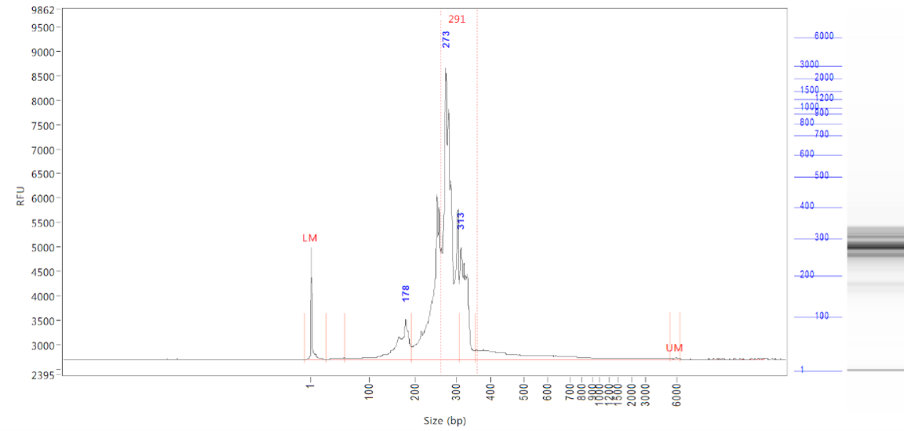
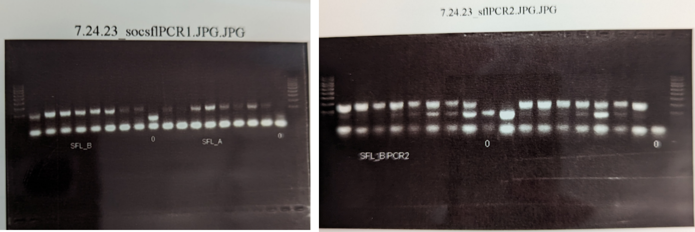

# GT-seq Library Preparation
Texas A&M Center for Marine Aquaculture

**Originally created:** 2026-11-25\
**Last updated:** 2026-11-25

# Purpose

Methods for preparing *Crassostrea virginica* Genotyping-in-Thousands by Sequencing (GT-seq) librarys at the Marine Genomics Lab at Texas A&M University-Corpus Christi. Please note that certain elements of this protocol are specific to the MGL.

# Overview

GT-seq library preparation follows the GT-seq methods described by Campbell et al. (2015), consisting of primer pool preparation, DNA extraction, two rounds of PCR, sample pooling, and sequencing. We try to have 1,800-2,000 sample per library, with the max number of samples being 2,256.

# Primer Preparation

Two different sets of primers will need to be prepared: a set of primers that have loci specific to the species being investigated (PCR1 loci-specific primers) and a set of primers that work as barcodes to differentiate individuals during demultiplexing (PCR2 i5 and i7 primers).

## PCR1 Loci-Specific Primers

1.  Resuspend IDT primers
    a.  Centrifuge primers, then resuspend to a 100uM concentration in 1x TE buffer (stock solution). If primers came as 5nmol, add 50ul of 1x TE buffer.
        i.  ***Note**: IDT has a [calculator](https://www.idtdna.com/page/support-and-education/decoded-plus/easy-resuspension-and-dilution-of-oligonucleotides/) for this, and more information on resuspending primers can be found on [IDT’s website](https://www.idtdna.com/page/support-and-education/decoded-plus/my-oligos-have-arrived-now-what-/).*
        ii. ***Math**: 100uM =100nmol/L, so, 5nmol in 50uL = 100umol/L*
2.  Make working solution plates
    a.  Aliquot 10-20ul of the resuspended primers to a new 96-well half-skirt plate.
    b.  Store stock solution at -20°C and working solution at 4°C.
    c.  ***Note**: We recommend only doing this during optimization, since many primer mixes will likely be made over a short time. Once optimization is complete, keep primers in the freezer and only take them out when a new primer mix needs to be made.*
3.  Make primer mix
    a.  OPTIMIZATION ROUND 1 ONLY
        i.  Add 1ul of each primer to a 1.5ml tube. Vortex well (at least 20 seconds) and centrifuge.
    b.  POST-OPTIMIZATION ROUND 1
        i.  Add the correct amount of each primer (aka, "loading") to a 1.5ml tube. Vortex well (at least 20 seconds) and centrifuge.
        ii. ***Note**: We use a spreadsheet that lists the primer name, plate, well, and volume to be added for each primer mix.*
4.  Dilute primer pools to desired concentration for PCR
    a.  ***Note**: OPTIMIZATION does both b and c, while POST-OPTIMIZATION only does c. Also note that the dilution needed will change based on the species and DNA extraction being used (e.g., Oyster SNP: 20nM magbind, 60nM chelex; Oyster microhap: 40nM magbind, 80nM chelex; Red snapper: 20nM magbind, 80nM Chelex; Red Drum: 20nM magbind). Testing multiple concentrations is ideal during optimization rounds.*
    b.  Calculate the concentration of each individual primer in the primer mix:
        i.  EXAMPLE - 165 primers at 100uM, with 1ul of each added to the mix
        ii. C₁V₁ = C₂V₂
        iii. (100uM)(1ul) = (C₂)(165ul)
        iv. C₂ = 0.6060M or 606nM
    c.  Use the nM concentration to dilute the primers for PCR
        i.  EXAMPLE - make 150ul of 80nM primer mix
        ii. C₁V₁ = C₂V₂
        iii. (606nM)(V₁) = (80nM)(150ul)
        iv. V₁ = 19.8ul → Add 19.8ul of primer mix to 130.2ul of molecular-grade water

## PCR2 i7 and i5 Primers

1.  Resuspend IDT primers
    a.  Centrifuge primers then resuspend to a 100uM concentration in 1x TE buffer (stock solution). Similar to above, if primers come as 5nmol, add 50ul of 1x TE buffer
2.  Dilute primers to 10uM concentration in
3.  Make working solution plates
    a.  Aliquot 10-20ul to a new 96-well half-skirt plate
    b.  Store stock solution at -20°C and working solution at 4°C

# DNA Extractions

We use two main methods for DNA extractions: Mag-Bind® and Chelex. Filter tips should be used during all extractions, and plates should contain 94 samples rather than 96 to account for PCR1 and PCR2 nulls (these will be placed in H11 and H12 on a 96-well plate). Mag-Bind® is used during optimization and for obtaining high-quality DNA from important samples (e.g., broodstock). Chelex is used primarily due to having a large number of individuals per library.

## Mag-Bind® Blood & Tissue DNA Kit

1.  Tissue Lysis
    a.  Transfer approx. 10mg tissue into a 96-deepwell plate or 1.5ml tube.
    b.  Add 250ul TL buffer + 20ul Proteinase K (from kit, stored at room temperature) to each sample.
    c.  Incubate at 55°C on a plate shaker until the tissue is fully lysed. Plates shake at 800 rmp, tubes at 1000 rmp. Samples can stay on the shaker overnight, or can be moved to the fridge. If moved to the fridge, the samples will need to be re-warmed to 55°C before the cell lysis step. ***Note**: swabs do better with longer sharker times, while oyster tissues usually lyse within a few hours.*
2.  Cell Lysis
    a.  Centrifuge tissue lysis plate/tubes for 5min to pellet undigested material.
    b.  Transfer 200ul of supernatant to new deepwell plate/tubes.
    c.  Add 230ul AL Buffer and mix well by pipetting.
    d.  Incubate for 10min at 24°C in plate shaker (300-350 rpm).
3.  Bind DNA to beads
    a.  Make master mix (MM): 320ul HDQ Binding Buffer + 20ul MagBind® Particles HDQ per sample + 1 extra.
    b.  Add 340ul MM to each sample and mix well by pipetting.
    c.  Incubate for 10min at 24°C in a plate shaker (300-350 rpm).
    d.  Place plate/tubes on a magnet and wait for the beads to clear from the solution.
    e.  Aspirate approximately 600ul of supernatant and discard.
    f.  Take plate/tubes off the magnet and resuspend beads in remaining 170-200ul.
    g.  Transfer remaining liquid with beads to 96-well half-skirt plate (skip if using tubes).
    h.  Place plate/tubes on a magnet and wait for the beads to clear from the solution.
    i.  Aspirate and discard supernatant.
4.  VHB Wash
    a.  (Optional): If beads remain in deep-well plates, add 150ul VHB Buffer to each sample well, resuspend remaining beads, and transfer entire volume of VHB Buffer with beads to the half-skirt plate.
    b.  Remove plate/tubes from the magnet and resuspend the beads in 150-200ul VHB Buffer c. Incubate for 1min at 24°C.
    c.  Place plate/tubes on the magnet, wait for beads to clear, aspirate and discard supernatant.
    d.  Repeat VHB Buffer wash steps b-d.
5.  SPM Wash
    a.  Remove plate/tubes from the magnet and resuspend the beads in 150ul SPM Buffer.
    b.  Incubate for 1min at 24°C.
    c.  Place plate/tubes on the magnet, wait for the beads to clear, aspirate and discard supernatant.
6.  Elution
    a.  Remove plate/tubes from the magnet and resuspend the beads in 100ul warm (70°C) molecular-grade water.
    b.  Incubate for 5min at 24°C.
    c.  (Optional): Put the plate/tubes on the magnet, wait for beads to clear, then transfer supernatant with DNA to new half-skirt plate/tubes.
    d.  Store at 4°C (short-term) or -20°C (long-term, off beads required).

## Chelex

1.  Make 10% Chelex solution (if needed)
    a.  To a glass bottle, add 10g of Chelex powder and 100ml of molecular-grade water. Mix well by inverting the bottle. Add a stir bar and store at 4°C.
2.  Make ProK (if needed)
    a.  To a glass amber bottle of ProK powder (stored at -20°C), add 10ml of ProK buffer (stored at 4°C) and mix well by inverting the tube. Aliquot all the liquid from the amber bottle to 1.5ml microcentrifuge tubes and store at -20°C.
3.  Pre-heat 10% Chelex solution to 60°C in an incubator (takes \~1 hour).
4.  Cut very small pieces of tissue/swabs and place inside a 96-well half-skirt plate.
5.  Place warmed Chelex on stir plate. Make sure the solution is being stirred and heated. 6. Add 100ul of Chelex + 5ul of ProK to each well.
6.  Lightly vortex samples.
7.  Run the following protocol on a thermocycler: 90min \@ 60°C; 15min \@ 95°C; hold \@ 10°C. ***Note**: This can also be done using an incubator and/or plate shakers if thermocyclers are not available.*
8.  Centrifuge for 3.5min \@ 6000 rmp.
9.  (Optional): Pipette clean supernatant (DNA) to a new plate.
10. Store at 4°C. Chelex extractions are usually good for up to 2 months.

## Post-Extraction QC

Post-extraction quantification is not always necessary. It is recommended that at least some samples are quantified to ensure extractions worked (broadly). Chelex extracted DNA concentrations (swabs) can be low for PCR1 (\<1ng/ul) but still work. We have found that dilutions are not necessary for swab samples. We do find it necessary for tissue extractions, as they tend to have higher DNA concentrations.

1.  Quant DNA extractions with the AccuBlue® High Sensitivity quant kit
2.  Tissue DNA dilution
    a.  Dilute DNA to be between 5-25ng/uL in molecular-grade water. EXAMPLE: a tissue quant of 50ng/ul gets a dilution factor of 10, making the quant after dilution 5ng/ul (10/50ng/ul). In this example, 1ul of DNA will be added to 9ul of molecular-grade water.
    b.  Store at 4°C b.

# PCR1

While this protocol follows Campbell et al. (2015), changes have been made to the number of denaturation cycles. The general reaction for PCR1 is 7ul total, as follows:

- 3.5ul Qiagen multiplex PCR plus master mix (MM)
- 1.5ul Locus-specific primer mix
- 2.0ul DNA

The thermocycler protocol is as follows:

- 15min \@ 95°C
- 20 cycles: 30sec \@ 95°C, 5% ramp to 57°C for 30 sec, 72°C for 2 min
- 10 cycles: 30sec \@ 95°C, 30sec \@ 65°C, 30sec \@ 72°C
- Hold \@ 10°C

1.  Make strip tubes for Qiagen MM and primer mix (pmix) (for multichannel purposes)
    a.  Calculate how much of each is needed and add to strip tubes.
    b.  EXAMPLE: for a plate of PCR1 with 94 samples...
        i.  (3.5ul per well \* 8 rows per plate) + 3ul extra = 31ul of Qiagen MM to per strip tube
        ii. (1.5ul per well \* 8 rows per plate) + 3ul extra = 15ul of pmix per strip tube
2.  To each well (excluding H12), add:
    a.  3.5ul of Qiagen MM (no need to change tips)
    b.  1.5ul of pmix
        i.  To avoid missing a well, place the drop on the side of the well and then before adding DNA, gently tap the plate on the bench to move the droplets off the side and into the Qiagen MM.
    c.  2.0ul of DNA
        i.  H11 will get RNAse-free water from the Qiagen kit instead of DNA.
3.  On a thermocycler, run the protocol outlined above (run time \~2 hours).
4.  Quant PCR1 product with the AccuBlue® High Sensitivity quant kit.
5.  (Optional): Gel PCR1 product.
6.  Dilute PCR1 to 2-5ng/uL with molecular-grade water. ***Note**: we typically shoot for 3.5ng/ul.*
7.  Store at 4°C.

# PCR2

The general reaction for PCR2 is 10ul total, as follows:

- 5.0ul Qiagen multiplex PCR plus master mix (MM)
- 1.0ul i5 primer (#1-96) - each well gets its own
- 1.0ul i7 primer (#1-24) - each plate gets its own
- 3.0ul Diluted PCR1 product

The thermocycler protocol is as follows:

- 15min \@ 95°C
- 10 cycles: 10sec \@ 98°C, 30sec \@ 65°C, 30sec \@ 72°C, 5min \@ 72°C
- Hold \@ 10°C

1.  Make strip tubes for Qiagen MM (for multichannel purposes).
    a.  Calculate how much MM is needed for each well, then add that amount to strip tubes.
    b.  EXAMPLE: for a plate of PCR2 with 94 samples...
        i.  5.0ul/well \* 8 rows/plate = 40ul of Qiagen MM to each tube + 5ul extra
2.  To each well, add:
    a.  5.0ul of Qiagen MM (no need to change tips)
    b.  1.0ul of well-specific i5 primer and 1.0ul of plate-specific i7 primer
        i.  To avoid missing a well, place drops on the side of the well and then before adding the next drop or DNA, gently tap the plate on the bench to move the droplets off the side and into the Qiagen MM.
    c.  3.0ul of diluted PCR1 product
        i.  H12 will get RNAse-free water from the Qiagen kit instead of diluted PCR1 product.
3.  On the thermocycler, run the protocol outlined above (run time \~1 hour).
4.  Quant PCR2 product with the AccuBlue® High Sensitivity quant kit.
5.  (Optional): Gel PCR1 product.
6.  Store at 4°C.

# Standardizing/Pooling

There are two methods for standardizing and pooling GT-seq libraries: the “normal” method and the “quick” method. The “normal” method should be used during optimization and requires quants for all samples. For bigger libraries with multiple plates and thousands of samples, the “quick” method is preferred since quants are not required.

## Normal Method

1.  Standardize PCR2 products to the lowest quant. Don’t standardize lower than 20ng/ul
    a.  Use this equation to calculate the amount of each sample to pool: (Lowest quant / quant of well) \* 7
2.  Using the resulting calculated value, pool all the samples into a 1.5 ml tube. Make sure there are ≥50ul pooled for cleaning.
3.  Vortex sample thoroughly and centrifuge.
4.  Store at 4°C.

## Quick Method

1.  Using a multichannel, pull 4ul from each well in a plate and add to a set of strip tubes.
    a.  ***Note**: Plates containing more than one type of ploidy (tetraploids or triploids) will need to have an adjusted amount of sample pulled for individuals that are not diploid.*
2.  Pull all the liquid from each strip tube and add to a single 1.5ml tube.
3.  Vortex sample thoroughly and centrifuge.
4.  Store at 4°C.

# Duel-Sided Cleans

In a Dual-End clean, two cleans are performed. The first clean (0.4X) allows beads to grab onto large pieces of DNA (≥500bp), then removes the beads and attached DNA. The second clean (0.7X) binds to DNA fragments ≥200bp (target product) and removes smaller products. A third, single-ended 0.7x clean will remove additional small DNA fragments (\<200 bp). This third clean is optional and is now only be done if the results from the fragment analyzer are not very good and we think an additional clean will help. *Step 6* outlines this additional third clean.

1.  For each pool, get two 1.5ml tubes. Label each tube with the run_id, clean step (0.4x or 0.7x), and the pool number.
2.  Aliquot MagBind® TotalPure NGS beads:
    a.  Add 20ul of NGS beads to each 0.4x tube
    b.  Add 15ul of NGS beads to each 0.7x tube
3.  Vortex and centrifuge each pool.
4.  0.4x Clean
    a.  Add 50ul of the sample pool into the correct 0.4x tube and pipette to mix.
    b.  Vortex well, very briefly centrifuge (enough to pull down the liquid but not long enough to pellet the beads), and incubate for 5min at 24°C.
    c.  Put the 0.4x tube on a magnet and wait for the beads to clear.
5.  0.7x Clean
    a.  Pull 70ul of supernatant from the 0.4x tube on the magnet and add to the correct 0.7x tube. Pipette to mix. ***Note**: the 0.4x tube is no longer needed, but we keep this tube until the fragment analyzer is ran.*
    b.  Vortex well, very briefly centrifuge, and incubate for 5min at 24°C.
    c.  Put the 0.7x tube on the magnet and wait for the beads to clear.
    d.  Set pipette to 100ul and remove supernatant (everything but the beads), then use a p10 pipette to remove any remaining small amounts of liquid.
    e.  Still on the magnet, wash the beads with 70% EtOH.
        i.  Slowly add 60ul of ethanol above the beads to the EtOH washes over them.
        ii. Carefully remove the ethanol and eject over the beads an additional 4-5 times. The goal is to have the EtOH in contact with the beads for \~30sec.
        iii. Pull ethanol from the tube and discard.
        iv. Repeat step e for a second wash.
    f.  After the second wash, use a p10 pipette to remove any remaining small amounts of EtOH.
    g.  Let the beads dry for \~2min – Note: you don’t want the beads to crack, but not be super wet either
    h.  Resuspend the beads.
        i.  Take 0.7x tube off the magnet and add 15ul of molecular-grade water.
        ii. Pipette to mix, vortex well, very briefly centrifuge, and incubate for 5min at 24°C.
        iii. For short-term storage, the water and beads can stay together at 4°C.
6.  (Optional) 0.7x Clean (3x)
    a.  ***Note**: if doing this step, then step 5h must be adjusted. Instead of resuspending the beads in 15ul of water, resuspend in 25ul.*
    b.  Label another 1.5ml tube "3x" and add 14ul of NGS beads to it.
    c.  Put the 0.7x tube on the magnet and wait for the beads to clear.
    d.  Pull 20ul off the beads in the 0.7x tube and add to the 3x tube. Pipette to mix.
    e.  Vortex well, very briefly centrifuge, and incubate for 5min at 24°C.
    f.  Put the 3x tube on the magnet, wait for the beads to clear, pull and discard all supernatant.
    g.  As in 5e, wash the beads twice with 70% EtOH.
    h.  Let the beads dry for \~2min.
    i.  Resuspend the beads
        i.  Take 3x tube off the magnet and add 5ul of molecular-grade water.
        ii. Pipette to mix, vortex well, very briefly centrifuge, and incubate for 5min at 24°C.
        iii. For short-term storage, the water and beads can stay together at 4°C.
7.  Quant the cleaned pool with the AccuBlue® High Sensitivity quant kit.

# Fragment Analyzer

Before sequencing, checking the quality of the library is necessary. We use an Agilent Fragment Analyzer to do this.

1.  **Sample Preparation**. Prepare samples to have a concentration in the 2.5-5ng/µl range in molecular-grade water. 2ul of sample is added to the fragment analyzer, so the final dilution volume should be more than that and should take into account final pooling needs. EXAMPLE: for a 42ng/ul sample, 1ul of sample + 11ul of water produces a sample of 3.5ng/ul.
2.  **Materials**. Defrost intercalating dye, ladder, and diluent marker stored at -20°C. Collect the fragment analyzer kit from the fridge.
3.  **Computer/Machine**. Turn on computer and the fragment analyzer machine. Open the fragment analyzer application on the desktop. After logging in, the machine will make loud noises. Wait for these to finish.
4.  **Gel**. Remove the 50ml falcon tube from "Gel 1" location inside machine. Check the solution level (*Utilities/Solution Levels*) and top-up NGS fragment separation gel to 12.5 or 15ml. 12.5ml is fine if you are running one row, but 15ul is needed for two. After vortexing and spinning down the intercalating dye, add the appropriate amount to the tube. Vortex to mix well and let rest in the drawer until you are ready to start the run. All the bubbles should be clear and the gel should be at room temperature by the time the machine starts. GEL PREPARATION EXAMPLE: Solution level = 8.3ml, goal is 15ml. Add 6.7ml of NGS fragment separation gel to the tube to get to 15ml (this can be eyeballed), then add 0.67ul of intercalating dye to the tube.
5.  **Capillary Conditioning**. \~4ml of capillary conditioning solution is needed per row. You can check the solution level in *Utilities/Solution Levels*. If the volume is too low to run, remove the tube from the "Cond" location inside the machine. If a new kit is being used, you will need to prime the capillary by selecting *Utilities/Prime*, then *Gel 1* and *OK*. To make more solution, add 20ul molecular-grade water + 5ul 5x capillary solution OR 40ul molecular-grade water + 10ul 5x capillary solution. Similar to the gel, vortex to mix and let rest until ready to start the run.
6.  **Solution Levels**. Select *Utilities/Solution Level* and update the Gel 1 volume (and capillary conditioning if needed).
7.  **Inlet Buffer**. Select *Operations/Park*. Wait for the plate to deposited in the drawer. Once the machine has stopped making loud noises and the green light on the side has lit up, open Drawer B and remove the deep-well plate. Completely aspirate the liquid from each well in row A. It is recommended to aspirate 550ul twice. With a new tip, refill each well in row A with 1.1ml 1x 930 dsDNA inlet buffer. Place the plate back in Drawer B, making sure the plate is loaded with well A1 in the top left corner. Select *Operations/Store* to return the plate into the storage position. Wait for the machine to stop making noises before proceeding. To make more buffer, add 50mL 5x930 dsDNA + 200ml molecular-grade water.
8.  **TE Rinse Buffer**. Open Drawer M and remove the 96-well plate. The last row used should be marked. In the next available row, add 100ul 0.25x TE rinse buffer found in the box from the fridge. Mark the row after filling with an X and the date. Tap the plate gently on the lab bench to ensure all the liquid is at the bottom of the wells and there are no bubbles present, then place back in Drawer M with well A1 in the top left corner.
9.  **Sample Plate**. Remove sample plate (usually Drawer 1). Vortex and spin down the NGS fragment diluent marker and DNA ladder. The last row used should be marked and dated. In the next available row, add 24 or 25ul NGS fragment diluent marker solution to each well in which a sample or ladder will be added (column 12 is always the ladder). Fill any unused wells with 24ul blank solution. Add 3ul NGS fragment DNA ladder to well 12 and slowly pipette to mix. Add 2ul of each sample to the appropriate well and slowly pipette to mix. Mark and date the row. Tap the plate gently on the lab bench to ensure all the liquid is at the bottom and no bubbles are present (very important!!). If necessary, use a tip to remove bubbles. Place the plate back in machine with A1 in the top left corner.
10. Place the 50mL gel falcon tube back into the machine in the Gel 1 location. Ensure the fluid line is positioned at the bottom of the tube. Do the same with the capillary conditioning if necessary.
11. **Load the run**. Select *Operations* and the sample tray in which you placed your sample plate (usually 1). Select the row in which you added your samples and label each well (e.g. sample_1, blank, ladder). Under *Run Selected Row*, select *Edit Method*. Select *Load* and protocol *DNF-474-33-HSNGS Fragment 1-600bp*. Make sure Gel 1 is selected and the rinse row matches the row filled in the plate in Drawer M. Under *Run Selected Row*, select *Add to Queue*. Ensure the correct method, gel, sample plate and well are selected.
12. **Run**. Click the green arrow to run the machine. Try to run it as soon as possible after preparing. One row usually takes \~70 minutes.
13. **Retrieve data**. Open the ProSize application on the desktop. Go to move to the folder labeled with the date of the run and open the file. If the ladder does not run, you can import one that has been saved. If this happens, make sure to apply the ladder to all samples. Occasionally, peaks are not flagged. To add a peak, right click and select *Add Peak* then right click in the same spot and select *Accept Changes*. The same might happen for Upper and Lower markers. If needed, right click, then select *Set as Upper Marker* or *Set as Lower Marker*.
14. **Smear Analysis**. Use a smear analysis to check what percent of the library is made up of your target sequences, and if the target bp were achieved. This is your original target size + the primers (\~160bp). For an optimized library the % should be \>50%. ***Note**: a “good” library will have a relatively normal distribution that peaks around 230-250 bp (this number could change but is consistently in this range).*
15. **Save data**. A PDF of the data can be exported from ProSize to a USB drive. You can also save the entire data folder to a USB drive, which can then be opened on the ProSize software elsewhere.

EXAMPLE:

# Final Pooling for Sequencing

Sequencing preparation depends on the sequencing facility being used. Make sure you know where samples are going before continuing. We typically sequencing on an Illumina NovaSeq 6000 (paired end 2x150bp, Illumina, San Diego, CA) at Genewiz by Azenta Life Sciences (South Plainfield, NJ).

1.  Confirm pool quants with the AccuBlue® High Sensitivity quant kit.

2.  We use a specific excel calculator for pooling multiple plates together.

3.  Quant final library with Qubit™ quant kit or AccuBlue® High Sensitivity quant kit before sending out for sequencing.

4.  Calculate the nM in your library for sequencing using Illumina’s equation. Use the fragment analyzer smear analysis results to get the average bp size of the library. This includes any dimer/adapter dimer.

    $$
    \frac{\text{concentration in ng/}\mu\text{l}}{660\ \text{g/mol} \times \text{average library size in bp}} \times 10^{6} = \text{concentration in nM}
    $$

5.  Make sure that the final library you send is within the requirements of the sequencing facility being used.

# General Procedures

## AccuBlue® High Sensitivity Quant Kit

For this quant kit, we use 4 standards (0x, 0.5x, 4x, and 10x) done in replicate for a total of 8 per run.

1.  Make master mix (MM) and thoroughly vortex:
    a.  \# samples + 8 standards + 1 extra = rxns
    b.  rxns x 200 = total buffer
    c.  rxns x 2 = total enhancer
    d.  MM = total buffer + total enhancer
2.  Set up plate:
    a.  Sample wells: 199ul MM + 1ul of sample
    b.  Standard wells: 190ul MM + 10ul of standard
3.  Place on plate shaker for 5min at 90 rpm.
4.  Using a SpectraMax M2 machine with the SolfMax Pro program, set sample concentrations to 200 and stardard concentrations to 0, 0.025, 0.2, and 0.5.
5.  Read the quants, then change the standard curve to *quadratic.*
6.  Save results to the computer and export as an excel file to a USB drive.

## Qubit™ dsDNA Kit

1.  Obtain 0.5ml tubes for each sample + 2 for the standards. Label the top of the lids only with the plate number or standard number.
2.  Make master mix (MM) and thoroughly vortex:
    a.  \# samples + 2 standards + 0.5 extra = rxns
    b.  Rxns x 199 = total buffer
    c.  Rxns = total enhancer
    d.  MM = total buffer + total enhancer
3.  Set up tubes:
    a.  Sample tubes: 199 ul MM + 2 ul sample
    b.  Standard tubes: 190 ul of MM + 10 ul standard
4.  Vortex tubes, centrifuge, and let sit at 24°C for 3min
5.  Read quants on a Qubit™ 2.0 Fluorometer, using the *High Sensitivity dsDNA assay* option.
    a.  Standards should show up as a straight line on the graph, with points at 0 and \~500
    b.  Set *calculate stock calculation* to 2ul

## Quanting Tips

When quanting samples after extraction, PCR1, and PCR2, you can always quant every single sample on every single plate. However, that is time and reagent consuming, so we try to just get enough data from each plate to help inform us if things look “normal” or not. This outlines how we go about doing that.

1.  Instead of taking every sample, take a single column of samples from each plate:
    a.  Extraction plates = 8 samples per plate quanted
    b.  PCR1 plates = 9 samples per plate quanted (includes the PCR1 null)
    c.  PCR2 plates = 10 samples per plate quanted (includes the PCR1 and PCR2 nulls)
2.  Which columns should you quant? We have a system!
    a.  Match the column number to the plate (column 1 in plate 1, column 2 in plate 2, etc.). When you get to plate 11, go back to column 1 since H11 contains a null and we want 8 samples at a minimum.
    b.  List of plate number and what column to quant:

| **Plate \#** | **Column \#** |   | **Plate \#** | **Column \#** |   | **Plate \#** | **Column \#** |
|:---------:|:---------:|:--:|:---------:|:---------:|:--:|:---------:|:---------:|
| 1 | 1 |  | 9 | 9 |  | 17 | 7 |
| 2 | 2 |  | 10 | 10 |  | 18 | 8 |
| 3 | 3 |  | 11 | 1 |  | 19 | 9 |
| 4 | 4 |  | 12 | 2 |  | 20 | 10 |
| 5 | 5 |  | 13 | 3 |  | 21 | 1 |
| 6 | 6 |  | 14 | 4 |  | 22 | 2 |
| 7 | 7 |  | 15 | 5 |  | 23 | 3 |
| 8 | 8 |  | 16 | 6 |  | 24 | 4 |
        
3.  Recommendation for setting up quant plates: Have each row be a different plate, with nulls in columns 9 and 10 and the standards in column 12. This way, 8 plates can be quanted at once.

## Gel Electrophoresis

1.  Run all GT-seq gels with a 2% gel. 1.5% also works, but 2% is best for separating bands in GT-seq
2.  Goal is to load \~100ng of each sample in a 2:3 dye/water mix
    a.  Dye/water mix: \[(2ul of dye x \# of samples) + (3ul of water x \# of samples)\]
    b.  Add DNA/PCR product to 4ul of the dye/water mix. EXAMPLE: For sample with 60ng/ul, add 2ul to the dye/water
    c.  On the gel, load 5ul of the DNA in the dye/water
3.  Load 2.5ul of a 100bp ladder
4.  Run the gel at 90 volts for 85min. ***Note**: running at a lower voltage for a longer time will allow even more separation in the bands.*

EXAMPLE:

- Gel 1 = PCR1
  - If PCR1 worked, there should be 2 bands: 1 product band and 1 dimer band below the ladder. Nulls are labeled as "0". Primers add \~80-100bp to the original target size.
- Gel 2 = PCR2
  - If PCR2 worked, there will be 2-3 bands: 1 product band above 250bp, 1 adapter dimer band at 160bp, and 1 dimer band below the ladder. Nulls are labeled as "0". Primers add another \~80bp so product line is the original target + 160bp. If the panel is optimized, the adapter dimer band is usually faint.

# Supplies Used

Here is a list of all the supplies we use during GT-seq library preparation with their product numbers and vendor.

| **Product** | **Vendor** | **Product #** |
|:---|:---:|:---:|
| Half-skirt PCR Plates, 96-Well | VWR | 83007-374 |
| Aluminum Foil Seals for PCR (96-Well Plates) | VWR | 60941-126 |
| 96-Well Deep Well Microplates | VWR | 75870-792 |
| Extended 0.5-10ul Pipette Tips | VWR | 76323-398 |
| Standard 20-200ul Pipette Tips | VWR | 76323-400 |
| Standard 20-200ul Pipette Tips (Filtered) | VWR | 76322-150 |
| Standard 100-1,000ul Pipette Tips (Filtered) | VWR | 76322-154 |
| 1.7ul Microcentrifuge Tubes | VWR | 87003-294 |
| Axygen® PCR Tube Strips + Dome Cap Strips (8 Count) | VWR | 12000-206 |
| Mag-Bind® Blood & Tissue DNA HDQ 96 Kit | Omega | M6399-00S |
| 50g Chelex 100 Chelating Resin | Bio-Rad | 1421253 |
| 100mg Proteinase K | VWR | PAV3021 |
| QIAGEN Multiplex PCR *Plus* Kit | Qiagen | 206152 |
| Mag-Bind® TotalPure NGS | Omega | M1378-01 |
| AccuBlue® High-sensitivity dsDNA quantification assay | VWR | 89139-008 |
| Qubit™ dsDNA Quantification Assay Kits, HS | Fisher Scientific | Q32854 |
| HS NGS Fragment Kit (1-6000bp) | Agilent | DNF-474-0500 |
