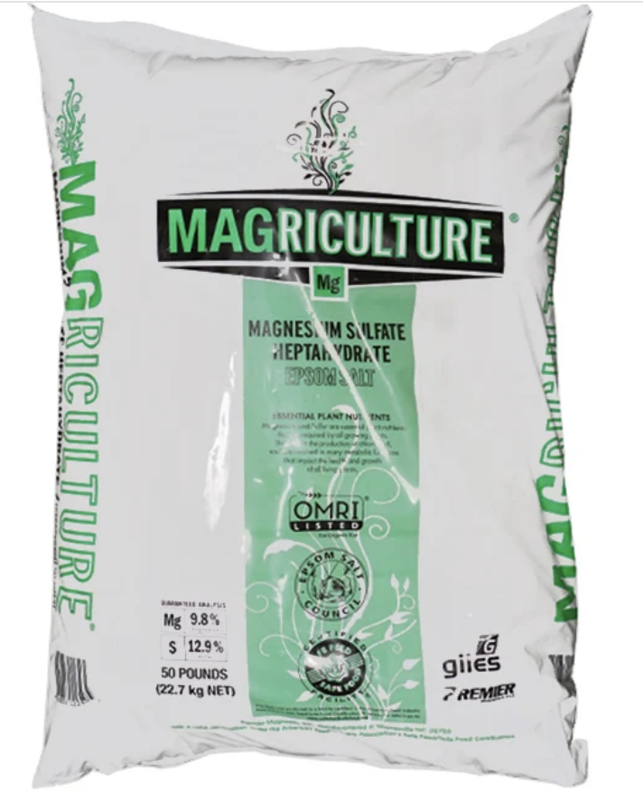
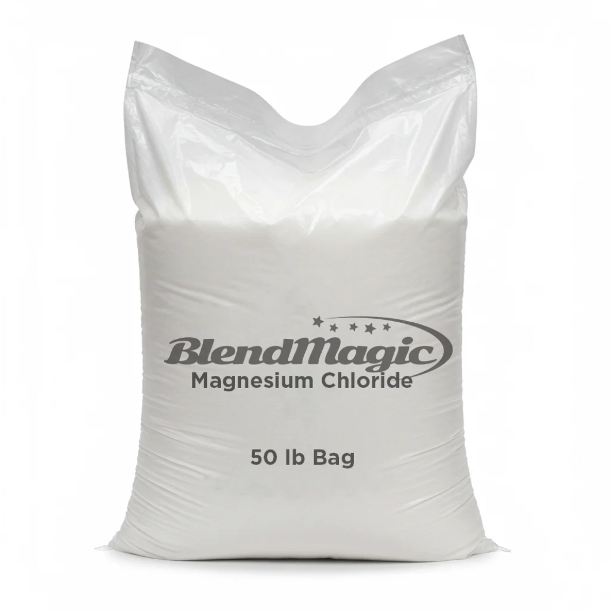
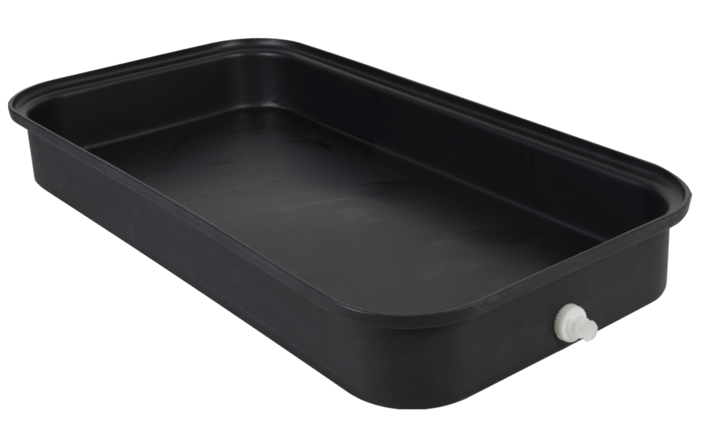
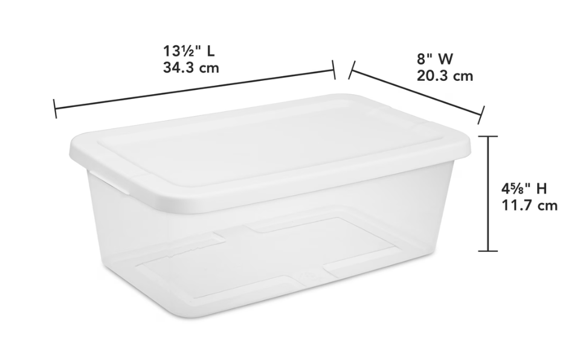
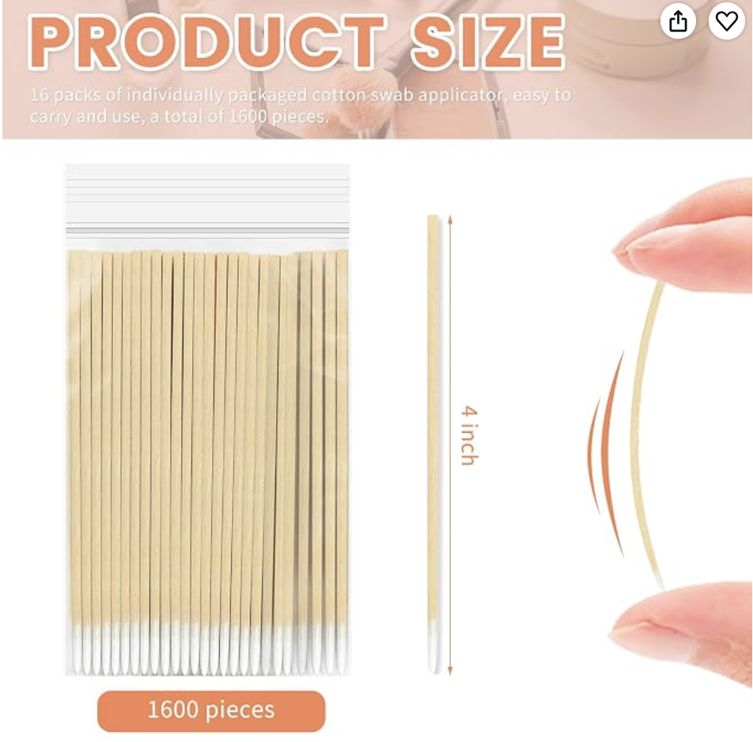

# Non-Lethal DNA Sampling of Eastern Oysters
Texas A&M Center for Marine Aquaculture

**Originally created:** 2026-11-17\
**Last updated:** 2026-11-17

# Purpose

Collect DNA for genetic analysis without sacrificing the oyster.

# Overview

Non-lethal collection of DNA in eastern oysters (*Crassostrea
virginica*) consists of anesthetizing oysters, swabbing their soft
tissue, and returning them to favorable conditions for recovery.

# Procedure

## Anesthetizing oysters

Oysters can be anesthetized so that their valves open using a solution
containing magnesium sulfate (Epsom salt) or magnesium chloride. Only
use unscented, pure magnesium sulfate or magnesium chloride. More
details on materials can be found at the bottom of the protocol. It is
important that the salinity of the solution is similar to the salinity
of the water the oysters originate from. Non-chlorinated freshwater is
therefore an essential component of the solution.

First, determine the volume of anesthetic solution needed to treat the
subject oysters. Consider the containers available, the number and size
of oysters, and that the oysters are to be fully submerged in the
solution. We often treat many oysters in a modest volume. We stock at
densities as high as approximately 600 adult (70mm) oysters in 50L.

The recipe of the anesthetic solution is:

- 3:2 non-chlorinated freshwater to working seawater

- 50g/L magnesium sulfate or magnesium chloride

  Here, working seawater is defined as filtered seawater with a salinity
  similar to the water from where the oysters that will be treated
  originate.

Once the salt is fully dissolved, place oysters in the solution with an
airline and an aquarium heater set to 26°C. Warming the water increases
the percentage of oysters that open. Oysters may remain closed for many
hours at temperatures below 18°C. Although some oysters may open
immediately, we typically place oysters in the solution just before the
end of the work day (4PM) to allow them to open overnight.

## Swabbing

The next morning, fill a small plastic bin with some of the anesthetic
solution from the container containing the oysters. Add a portion of the
anesthetized oysters to the bin, ensure the oysters are submerged, and
take the bin to the lab bench. Also, fill a separate small plastic bin
with working seawater and place it at the lab bench.

Pick up an oyster from the bin with anesthetic solution, letting any
liquid drain from the oyster back into the bin. Using a cotton tipped
microswab cut down to ~30mm, gently rub the cotton-end of the swab along
the mantle on both the flat and cupped shell, and if possible, adductor
muscle. Roll the swab while in contact with the soft tissue and ensure
the swab gets covered in mucus. Drop the swab into a labeled 1.5mL
microcentrifuge tube and close the lid. Place the oyster in the small
plastic bin with working seawater. Repeat on all oysters until all have
been moved from the bin of anesthetic solution to working seawater. Move
the recovering oysters to longer-term storage for recovery and repeat
the process until all oysters are swabbed.

## Recovery

Oysters placed in working seawater after swabbing tend to close their
valves and resume normal behavior within an hour. We suggest providing
oysters with favorable, clean conditions inside the lab or hatchery
while they recover. We typically place recovering oysters in a
recirculating system with working seawater at ~20°C for a few days. In
our experience, mortality from this process is rare.

# Notes

### Oysters not opening

- Oysters failing to open initially often open after more time in the
  anesthetic solution. We tend to give oysters 24hrs to open, however we
  have left oysters in the anesthetic for longer (30 - 40 hours) without
  mortality.

### Storage of swabs

- Store swabs without any buffer (dry in the tube). For long term
  storage (months to years), we store swabs in a -20°C freezer that has
  manual defrost settings. The manual defrost setting means the freezer
  will not go through freeze-thaw cycles. We suspect the quality of the
  DNA may degrade from thawing and re-freezing. For short term storage
  (days to weeks), we store swabs in the fridge (8°C). Having the swabs
  at room temperature on the benchtop is OK for a few hours, but we
  recommend moving them to the fridge as soon as possible.

### Cutting the swabs

We use utility scissors to cut the microswabs so they will fit in a
microcentrifuge tube. Place about 7-10 microswabs between the thumb and
index/middle finger, and cut to desired length.

# Materials

### Non-scented pure magnesium sulfate (Epsom salt) or magnesium chloride

### Treatment tub

### Benchtop bins

### Microswabs

