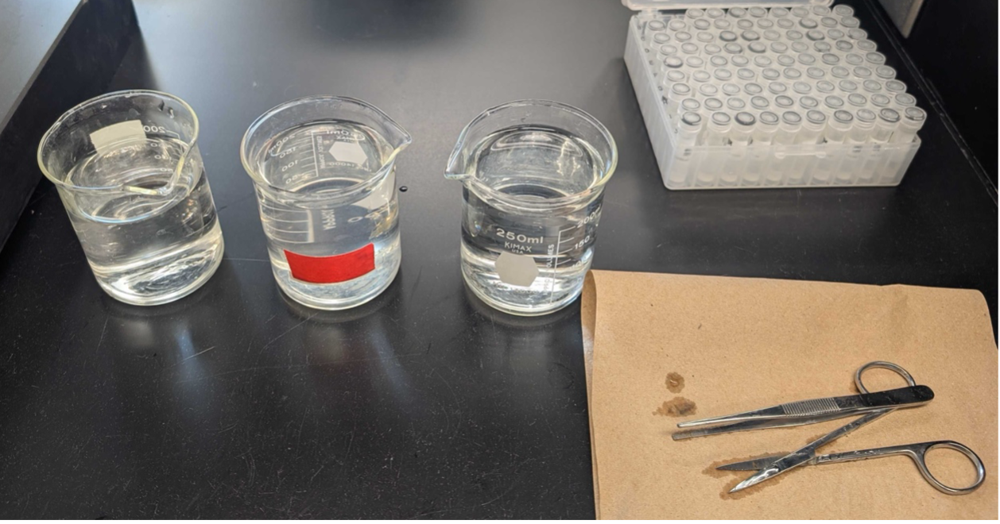
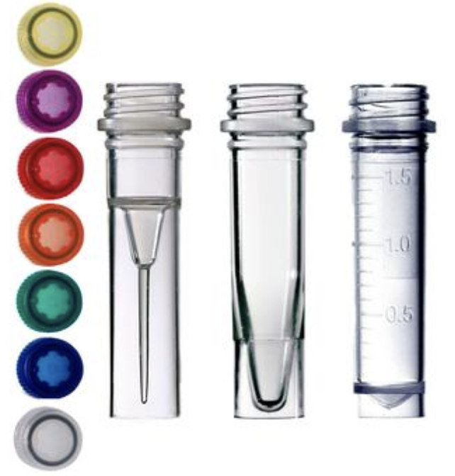

**Originally created:** \
**Last updated:** 

# Purpose

Collect and preserve oyster tissue for genetic analysis.

# Overview

Tissue sampling consists of cutting a piece of tissue, storing it in preservative, and sterilizing cutting tools between samples.

# Procedure

## Preservative

We use a salt-saturated DMSO buffer that is non-flammable, non-toxic, and stable at room temperature. The buffer is prepared in house. See recipe at the bottom of the protocol.

## Tissue collection

Using small scissors and forceps, cut a mantle tissue sample approximately 1 cm² in size from a freshly shucked oyster. Place the sample in a tube filled with salt-saturated DMSO buffer. We suggest using screw cap microcentrifuge tubes (example in Materials section). The sample should not take up more than 1/2 the volume of the tube and should be completely covered by the buffer. When sampling seed, a smaller tissue sample may be necessary. If seed are too small to shuck, consult Center staff for specific sampling instructions.

## Sterilizing tools

If possible, clean and sterilize tools between each sample using the following procedure:

1.  Rinse by swirling the tools in a beaker of freshwater.

2.  Swirl the tools in a beaker of bleach solution.

3.  Rinse by swirling the tools in a separate beaker of freshwater.

4.  Wipe the tools with a clean paper towel, ensuring that no residual tissue remains before collecting the next sample

{width="400px"}

*Example of set up for sterilizing your tools. From left to right, beaker of freshwater, beaker of bleach solution, beaker of freshwater. Recommended bleach solution is \~20mL household bleach (\~5% sodium hypochlorite) and \~180mL of freshwater.*

# Notes

- If using screw cap tubes, ensure that the caps are screwed on tight.

- Although the salt-saturated DMSO buffer is non-toxic, we recommend washing your hands after any skin exposure.

# Materials

### Screw cap tubes

{width="200px"}
# DMSO Recipe

